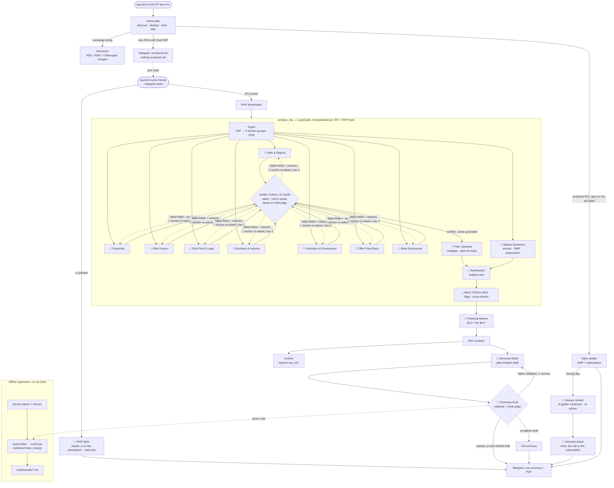
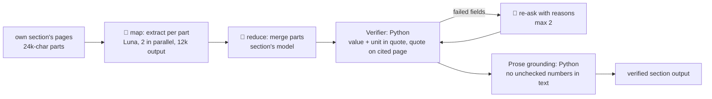

# Agents in the daily IPO run

This lists every agent and automated step that runs in the daily job, what each one sees, what it produces, and how context moves between them. For the full design, see `docs/specs/ipo-agents.md`.

Only steps marked 🤖 call a model. Everything else is deterministic Python. That split is intentional: discovery, parsing, maths, verification and rendering never use a model, so they can't make things up.

## The run at a glance

`launchd` starts the job at 10:30 IST on weekdays: `run_daily.py --ask-telegram` → `cli.main` → `runner.run_daily`. That run analyses nothing: it sends the daily updates and a numbered Telegram list of new IPOs. If there is nothing to offer and no update due, it sends one "😴 No mainboard IPO open today" line, so silence always means a fault. A second launchd job runs `run_daily.py --telegram-picks` every minute (`notify/picks.py`). A reply that reads as a question (ends in "?", starts with "ask", or has four words or more) goes to the RHP Q&A (below); everything else is a pick or a stop. It reads replies from your chat only and analyses just the IPOs picked. It confirms the pick ("✅ Got it"), then announces each analysis as it begins ("🚀 Analysis started … Reply "stop" or "cancel" to stop it"). While it analyses, a background thread (`StopWatcher`) checks the chat every 20 seconds without consuming replies. A stop sets a flag (`cancel.py`) that every metered model call checks first. The run then stops at its next call: the IPO is saved as `cancelled`, with its checkpoint kept, and picking it again resumes it. A reply with any word not understood starts nothing. A manual `run_daily.py` asks in the terminal instead (Enter = none), and `--updates-only` analyses none.

Every newly analysed IPO's summary is **evaluated before it is sent**, and exactly one summary goes out: the plain draft that passed, the best fully faithful draft, or the full summary. The "Offline regression" box runs the same loop on saved reports, so a prompt or model change can be checked before it reaches Telegram. See the Summary Eval section below and `evals/eval.md`.

The Verifier diamond above is the **verifier feedback loop**: each section agent's output is checked field by field, and failed fields go back to that agent with the reasons (up to 2 re-asks). Fields that still fail are kept as "could not verify", never guessed. In detail, inside each section agent: **map → reduce → verify → retry (up to 2)**.

## The agents

### Models
| Key | Model | $/1M in · out | Used for |
|---|---|---|---|
| `luna` | `gpt-5.6-luna` (OpenAI) | 0.20 · 1.20 | Bulk reading (map), long or descriptive sections, sentiment aggregate. Reasoning effort `none`: at `low` it spent whole budgets reasoning and returned nothing. |
| `terra` | `gpt-5.6-terra` (OpenAI) | 2.00 · 12.00 | Steps that drive the decision, and the peer-fit check. Reasoning effort `low`. |
| `groq` | `openai/gpt-oss-120b` (Groq) | free tier | Small calls (sentiment stance tags). Any Groq failure, or a call over 6k tokens, falls back to Luna. |
| `sol` | `gpt-6.1-sol` (OpenAI) | 2.00 · 10.00 | Financial Advisor and Peer Valuation's choice of multiples (high reasoning effort) |
| `grok` | `grok-4.20-0309-reasoning` (xAI) | 1.25 · 2.50 | The closing-day Demand Check, and the Summary Eval judge: a model from another company than the editor's (Terra, OpenAI), so it never grades its own family's writing. It reasons by default; xAI bills reasoning tokens on top of `completion_tokens`, and the meter adds them. |

Terra also runs the Summary Editor. The `xai` provider goes through the OpenAI client at `https://api.x.ai/v1` and needs `XAI_API_KEY` while a routed model uses it. `evals/advisor_compare.py` runs the Financial Advisor on Sol and on Grok side by side, to decide whether to switch it.

The routing lives in `config.yaml` (`routing:`). Once spend passes 70% of the $4.00 analysis cap, Terra tasks move down to Luna. Models with a reasoning effort are sent no temperature (Sol rejects it).

### Section agents
There are 8 section agents, all built on one generic engine (`section_agent.py`), each with its own prompt and schema (`sections.py`). Each one reads **only its own section's pages** and returns structured output. Every number in that output is a `Fact` (value, unit, page, verbatim quote), and every cited piece of text is a `Quote`.

| Agent | Who it is | Reads | Model (merge) | Python checks on its output |
|---|---|---|---|---|
| **Offer & Objects** | Offer-structure analyst | The Offer, Capital Structure, Objects of the Offer | Terra | OFS %, dilution, promoter holding change, GCP vs 25% cap (`calc.py`, `flags.py`) |
| **Financials** | Forensic accountant | Restated financials, MD&A | Terra (8k output) | PAT vs CFO, profit jump, receivable days, auditor remarks (`fin_calc.py`) |
| **Risk Factors** | Risk analyst | Risk Factors (top 25 kept, generic risks counted) | Luna (8k output) | Corroborates quantified risks with other sections (`cross_checks.py`) |
| **Fine Print & Legal** | Legal analyst | Litigation, approvals, material contracts, plus financial-note pages it borrows | Terra | Contingent liabilities vs net worth, related-party share of revenue, loans to promoters, criminal cases (`legal_calc.py`) |
| **Business & Industry** | Business analyst | Our Business, Industry Overview | Luna | Customer concentration, single plant or geography (`section_calc.py`) |
| **Promoters & Governance** | Governance analyst | Management, Promoters, Group Companies | Luna (its prompts exceed Groq's 6k limit) | Promoter pay vs PAT, pledges, conflicts, auditor/KMP churn |
| **Offer Price Basis** | Pricing analyst | Basis for Offer Price | Terra | Offer price vs WACA. Also extracts the RHP's peer table, the company's KPIs and the peers' operational KPIs from the "comparison of KPIs with listed peers" table (`peer_kpis`), all of which feed Peer Valuation |
| **Other Disclosures** | Compliance scanner | Every page no one else owns | Luna | None ("nothing material" is a valid answer); at most 10 items |

All 8 share:
- **Tools:** none. They only read the pages they're given; they can't browse.
- **Map calls:** Luna, with their own output limit (`map_max_tokens`, 12k). The section's own calls get `default_max_tokens` (16k).
- **Re-asks:** go to the section's own model.
- **Fail soft:** a section whose own reply can't be read (cut off or malformed) is marked "could not read" and skipped. Provider errors still fail the IPO, so the next run retries it.

### Market Sentiment 🤖 (`sentiment.py`)
- **Role:** collects what the market is saying, kept apart from RHP facts.
- **Tools:**
  - Tavily web search: reviews and broker notes published after the RHP. Spam filtered, at most 8 sources, or 4 when degraded.
  - InvestorGain: GMP, always labelled unofficial.
  - NSE subscription data, with Chittorgarh as fallback.
- **Models:**
  - Groq tags each article's stance, with the article fenced off as untrusted text.
  - Luna writes the bull and bear points.
- **Output:** third-party numbers only ever appear as `ClaimedFact`, which carries its source, URL and date.

### Peer Valuation 🤖 (`valuation.py`, `kpis.py`, `peers.py`)
Two model calls. Neither ever outputs a number.

**1. Choosing the multiples** (task `peer_valuation`, Sol at high effort):
- **Role:** an equity analyst who thinks about how this kind of business is valued, then picks 2 to 4 multiples, most important first, each with a reason.
- **Standard multiples:** P/E, EV/EBITDA, P/B (read with RoE, for lenders) and P/S (for loss-makers).
- **Business-specific multiples:** market cap or EV divided by a KPI the RHP discloses for the company and at least two peers. Examples: EV per subscriber (telecom), EV per bed (hospitals), EV per MW (power), EV per tonne (cement), market cap / AUM (lenders), EV/GMV (marketplaces), EV per employee (IT and BPO). The model names the KPI exactly as listed. A KPI that is a %, a ratio or days is never divided by.
- **Operating KPIs:** 3 to 6 KPIs to compare side by side with the peers (e.g. ARPU, attrition, revenue per employee).
- **Extra peers:** it may suggest up to 3 NSE-listed peers missing from the RHP's table. They are shown separately and set the median only when no RHP peer has data.
- **Sees:**
  - the business description, revenue mix and competitors;
  - the RHP's peer names;
  - whether the latest year is a profit or a loss;
  - the names of the KPIs the RHP discloses for the company and for its peers (with how many peers disclose each).

**2. Peer-fit check** (task `peer_fit`, Terra):
- **Role:** is each peer really a peer? For every RHP and suggested peer it gives a verdict (strong / partial / weak), 2 to 4 commonalities with the IPO and up to 3 differences.
- **Sees:** the IPO's business, revenue mix, competitors and claimed strengths, and each peer's Yahoo Finance sector, industry and business summary.
- **Weak peers are flagged, never dropped:** they stay in the median. `PEER_SET_WEAK` (info) is raised when most of the peers behind the median are weak.
- **Fails soft:** if the check fails, the peers are shown without verdicts.

**Tools (Python):**
- NSE quote and search, with manual symbol overrides in `config.yaml`, for price and market cap.
- yfinance for latest-year revenue, prior-year revenue, EBITDA, PAT, net worth, debt and cash, plus the company profile.
- `kpis.py` reads the RHP's KPI tables. It finds a KPI by name (footnote markers ignored) and a peer by name (prefix match). It takes the latest full fiscal year, never a stub. Rupee KPIs are converted to ₹ crore; counted ones keep their scale ("million subscribers").

**Calculations (Python):**
- IPO market cap and EV at the upper band.
- Every multiple, for the IPO and each peer. A KPI multiple is "×" for a rupee KPI and "₹ per unit" for a counted one.
- Peer median, min, max and the IPO's premium or discount.
- Each peer's revenue growth, EBITDA margin, PAT margin and RoE, set beside the IPO's own latest full year.
- For each operating KPI: the IPO's value, each peer's and the peers' median.
- Every input cites an RHP page or a third-party source and date. A missing number is reported as not computable, never filled in.

### Synthesizer 🤖 (`synthesizer.py`): the analyst view
- **Role:** gives a verdict (Subscribe long term / Listing gains / Neutral / Avoid) with reasons and red flags.
- **Model:** Terra, one call.
- **Sees:** an evidence digest of verified facts and derived numbers, flags, checks, the valuation read and sentiment. Every item carries an ID (`F:` `D:` `G:` `C:` `X:` `V:` `S:` `N:`).
- **Validation (Python):**
  - Points that cite an unknown ID are dropped, and so are points containing a number not in their cited evidence.
  - A Subscribe verdict backed only by GMP is downgraded to Neutral.

### Financial Advisor 🤖 (`advisor.py`)
- **Role:** an expert IPO advisor giving the headline **BUY / NO BUY**, with conviction, time horizon, reasons, key risks and what would change its mind.
- **Model:** `gpt-6.1-sol`, at high reasoning effort.
- **Budget:** its own ledger, `<ipo_id>:advisor`, with a $1.00 cap. It is separate from the analysis's $4.00.
- **Sees:**
  - The synthesizer's evidence digest.
  - The analyst view, as `A:` items.
  - Fresh market data, as `S:` items (only article points whose numbers are grounded).
  - Context, as `K:` items (days left to close, minimum investment).
  - It never sees raw RHP text.
- **Checks (Python):** same evidence-ID and number checks as the synthesizer. A BUY resting only on market data or the analyst view is cut to low conviction. Fewer than 2 surviving reasons means no advice.
- **When it runs:**
  - At the end of `analyse_rhp` on analysis day, so the PDF renders with the advisor box.
  - On closing-day morning, after reloading `report.json` and re-gathering sentiment. The ⏰ message shows "was NO BUY → now BUY" or "Same call".
  - Other daily updates repeat the latest call (after close, the closing-day one) with no model call. They go out while the IPO is open, then each weekday until the expected listing day (`store.expected_listing`: third weekday after close, T+3; holidays aren't known).
- **Fails soft:** if the advisor errors or hits its $1.00 cap, the analysis summary and PDF still go out.

### Demand Check 🤖 (`demand_check.py`): the closing-day call judged against the subscription
- **Role:** a second opinion on the closing-day call, from another company's model (Grok, `demand_check`). It explains why the subscription is where it is, reads retail demand on its own, and says whether the call still holds against it. It never changes the call.
- **Python decides the facts:** the demand level from the subscription (`config.advisor`: **high** at total ≥ 10× or retail ≥ 5×; **weak** when total or retail is below 1×; otherwise normal), and a **contradiction** when high demand meets a NO BUY or weak demand meets a BUY.
- **Input:** the advisor's digest, plus the call being judged (`R:` items) and the demand reading (`K:demand`).
- **Checks (Python):** the advisor's evidence-ID and number checks. No surviving reason means no check.
- **Output:** lines after the subscription in the ⏰ closing message, e.g. "🔎 Demand check: HIGH demand", 2–3 reasons, a "Retail:" line, then "⚠️ HIGH demand vs NO BUY: the call still holds. …" or "❗ … the check thinks demand weakens the call. …". Saved as `demand_check_<date>.json`.
- **Cost and failure:** about $0.05 a call (measured $0.046) on the advisor ledger. Without a subscription figure there is no call; if it fails, the normal update goes out.
- **IPO analysed on its closing day:** there is no separate closing update, so `reminders.closing_day_check` runs the check right after the summary (on `report.advice` and `report.sentiment`) and sends it as its own ⏰ message.

### RHP Q&A 🤖 (`rhp_qa.py`): questions on an analysed RHP, from Telegram
- **Role:** answers a question about one analysed IPO from its RHP only, citing PDF pages, in plain words (≤150 words). Follow-ups resume the IPO's last session (`telegram_state` `qa_sessions`).
- **Model:** the Claude Code CLI (`claude -p`, `config.qa.model`, default `sonnet`) on the Mac's Claude subscription: $0, not metered. Before each answer `claude auth status` must report a `claude.ai` login, else no answer; `ANTHROPIC_API_KEY` and other provider variables are stripped from its environment. Never a paid fallback.
- **Input:** it runs in `data/work/<ipo_id>/` with only Read, Grep and Glob, and searches `rhp_pages/page-NNNN.txt` (written once from `rhp.pdf`, OCR for scans) and `report.json`. No shell, writes or MCP servers; WebSearch and WebFetch only for a question that asks for the web (`WEB_ASK`: "web", "internet", "google", "search/check online"), with web facts cited by site and date; no user settings, CLAUDE.md files or Claude Code memory (`CLAUDE_CODE_DISABLE_CLAUDE_MDS`, `CLAUDE_CODE_DISABLE_AUTO_MEMORY`); stdin closed.
- **Context follows the chat:** a Telegram reply to an earlier message picks that message's IPO and sends its text to Claude with the question. Otherwise: the IPO named, else the chat's current IPO (`qa_ipo`: the last answered about; `runner.run_daily` sets it when a summary, or a single daily update, is sent), else the only one analysed; otherwise it asks. A short reply that is neither a pick nor a stop counts as a question when it is a reply to a message or within `qa.follow_up_s` (30 min) of the last answer (`qa_answered_at`). A question naming an IPO in the store or the latest offer that isn't analysed gets "X isn't analysed, so there's no RHP to answer from"; the prompt also refuses questions about another company.
- **Checks:** none in Python: the page citations are the guard. RHP text is data, never instructions.
- **Speed:** after an answer the picks job long-polls Telegram for `qa.window_s` (10 min), so follow-ups take seconds. Any failure (logged out, usage limit, timeout) is a "Can't answer right now: …" reply.

### Summary Editor 🤖 (`plain_summary.py`): the Telegram summary in plain English
- **Role:** rewrites the full summary for a reader with no finance background, keeping only what decides apply or not. The full detail stays in the attached PDF.
- **Output:**
  - one plain "why"
  - up to 3 reasons
  - up to 2 watch-outs
  - a listing signal (unofficial pre-listing trading and demand so far)
- **Model:** Terra (`summary_editor`). It runs one or two calls per newly analysed IPO: a draft, plus one revision if the Summary Eval fails it.
- **Python owns:**
  - the header: dates, band, smallest application = lot × upper price
  - the 🧭 call: the advisor's BUY / NO BUY in plain words, else the analyst view
  - the 📊 peer-multiples line, copied unchanged from the full summary (e.g. "P/E 24.6× vs peer median 26.3× (7% discount)"), at the user's request
  - the footer
  The model writes none of these.
- **Prompt rules:**
  - plain words with examples
  - no jargon or flag codes
  - "plainer, never broader": keep who did what, and what is pending or unchecked
  - never repeat a point
  - numbers only as written in the full summary
  - on a revision, it also gets its previous draft and the judge's feedback
- **Live checks:** any item with a number that isn't in the full summary, or with a flag code, is dropped. With no "why" or no reason left, there is no draft.
- **Tests:** `tests/test_plain_summary.py`. A conftest gate turns the editor and judge off unless a test is marked `@pytest.mark.summary_editor`.

### Summary Eval 🤖 (`summary_judge.py` + `plain_summary.evaluated_summary`): the gate before sending
- **Role:** evaluates every plain draft in the daily run, before anything goes to Telegram. Exactly one summary is sent per newly analysed IPO. Full explanation: [`evals/eval.md`](../evals/eval.md).
- **Rulebook (Python, free):** `plain_summary.problems()` checks:
  - 15 non-blank lines or fewer
  - no jargon and no flag codes (the 🧭 and 📊 lines are exempt)
  - every number traceable to the full summary
  - no line over 30 words
  - the call shown exactly
- **Judge (Grok 4.20 from xAI, `summary_judge`):** a model from another company than the editor's, so the editor's family doesn't grade its own work. It sees the full and the plain text and skips the lines Python writes. It scores five questions from 1 to 5:

  | Score | Question |
  |---|---|
  | readability_non_finance | can someone with no finance background follow it? |
  | decision_relevance | is every line about apply or not, with no filler? |
  | coverage | are the decisive points, the biggest risk and the listing signal there? |
  | faithfulness | does it say no more and no less than the source? |
  | no_repetition | is each point made once? |

  It also lists the leftover jargon, the missing decisive points and the filler lines.
- **Pass bar:** no rulebook problem, every score 4 or higher, and faithfulness 5.
- **Loop:** up to `MAX_ROUNDS = 2`.
  1. Draft, then evaluate.
  2. If it fails, the editor revises once with the feedback (rule problems, low scores with reasons, jargon to explain, points to add, filler to drop), then the eval runs again.
- **What is sent:**
  - the first draft that passes
  - else, the fully faithful draft (faithfulness 5) with the fewest rule problems and the highest total score
  - else, the full summary
  If the editor or the judge errors or hits the cap, the full summary is sent. A draft is never sent without a judge's score.
- **Budget:** about $0.02–0.04 per IPO (Terra editor ~$0.003 plus Grok judge ~$0.015 per round, 1–2 rounds), billed to the IPO's advisor ledger. The $5 per IPO cap doesn't change.
- **Archive:** in `reports/<ipo_id>/<run>/`:
  - `telegram_summary.txt`: what was sent
  - `telegram_summary_full.txt`: the full summary it came from
  - `summary_review.json`: every draft, with its rule problems, judge scores and pass/fail
- **Offline regression:** `evals/summary_eval.py` runs the same loop on the saved FusionCX and HD Fire reports and two fixtures.
  - **Ledger:** `eval-summary`, capped at $1.00 in total.
  - **Output:** `evals/results/<date>_<time>.md`.
  - **`--offline`:** runs the rulebook alone, with no model.
- **Status (2026-10-12, before the gate existed, single drafts):**

  | Score | Result |
  |---|---|
  | faithfulness | 5 on every case |
  | decision relevance | 5 |
  | readability | 3–4 |
  | coverage | 3–4 |

  No case passes yet. Faithful drafts are still sent; the full summary is sent only when no draft is faithful.

### Deterministic steps (no model)
| Step | Module | Does |
|---|---|---|
| Discovery | `discovery/` | Open mainboard IPOs from NSE, BSE and Chittorgarh. Every source is asked and the answers merged, the first source winning on duplicates. Filters out SME issues and holds DRHP-only IPOs. |
| RHP downloader | `discovery/download.py` | Streams the PDF from an https allowlist of hosts, with size and zip-bomb guards. |
| Ingestion | `ingestion.py` | Maps ToC pages to 8 groups, guarantees 100% page coverage, OCRs scanned pages. |
| Verifier | `verifier.py` | Checks each value and unit appear in its quote, and the quote is on the cited page (exactly, else a fuzzy match scoring 90+ whose matched text still holds the value). A zero printed as "Nil" or "-" counts. |
| Prose grounding | `grounding.py` | Strips or replaces model-written text that contains unchecked numbers. |
| Calcs, flags, cross-checks | `calc.py`, `*_calc.py`, `flags.py`, `cross_checks.py` | All arithmetic and every red flag, computed from verified inputs only. A rupee amount of zero is ₹0 whatever unit it is printed with (e.g. "Nil"). |
| KPI tables | `kpis.py` | Looks up the company's and peers' KPIs for Peer Valuation; latest full year, units to amounts. |
| Budget meter and router | `budget.py`, `router.py` | Checks worst-case cost before each call, logs actual cost after, handles degrade, Groq fallback and retries. |
| Renderer | `report/` | Report JSON → HTML → PDF with page references. Never calls a model. |
| Notifier | `notify/` | Telegram summary and PDF, daily GMP and subscription updates, closing reminders. The message sent is the Summary Editor's plain-English one, after the Summary Eval passes it. The full summary (`runner.format_summary`), which the editor works from and which is sent when the editor can't produce a message, carries the advisor's call, reasons and risks in full; the valuation line; an operating-KPI line; a Peers block (one line per peer: verdict, multiples, revenue and growth, PAT margin, what it shares with the IPO); and "What the market is saying" (a Python read of stance tally, GMP and subscription). Messages over Telegram's 4,096 characters are split between lines. |
| Archive | `archive.py` | Saves each analysis under `reports/<ipo_id>/<date>_<time>[_partial]/` (report JSON, PDF, the exact summary sent) and each daily update under `updates/<date>.txt`. Archiving never stops a send. |

## How context is shared

There is no shared conversation between agents. Each model call is stateless and receives exactly the input listed below. Context moves only through typed, verified data.

| From → to | What travels | What is kept out |
|---|---|---|
| Ingest → section agent | That section's pages, tagged `[page N]` | Every other section's pages |
| Section agent → graph state | `findings[group]`, verified output only; `unverified` lists failed field paths | Rejected values (cleared to "could not verify") |
| Sections → Peer Valuation | Business description, revenue mix, competitors, RHP peer table, the KPI names in the RHP's KPI tables (values stay in Python), verified financials, shares and band | Raw pages; any number |
| Peer data → peer-fit check | Each peer's NSE symbol and Yahoo sector, industry and business summary | Peer numbers |
| All → Synthesizer | The evidence digest: verified items with IDs, derived numbers, flags, sentiment | Unverified values, raw text |
| Synthesizer + market → Advisor | The digest, the analyst view (`A:`) and fresh sentiment, GMP and subscription | Raw text; anything not in the digest |
| Report → renderer and Telegram | The `Report` model (Pydantic) | — |

LangGraph state (`analysis.AnalysisState`) has these fields:
- `ipo`, `rhp_pdf`, `doc`
- `findings`: one entry per section, merged
- `unverified`: appended to by each node
- `sentiment`, `valuation`, `synthesis`, `synthesis_error`

## Persistent memory

These are files the run reads and writes. All of them are local and gitignored.

| File | Written by | Read by | Holds |
|---|---|---|---|
| `data/ipo.db`, table `ipos` | Runner, Store | Runner, daily updates, dry run | Each IPO's status (`discovered`, `waiting_rhp`, `analysing`, `done`, `failed`, `failed_budget`), dates, band, symbol, verdict, report path, date of last update |
| `data/ipo.db`, table `llm_calls` | Budget meter | Budget meter, router, `--reset-budget` | Every model call: ledger, task, model, tokens, cost. Spend per IPO and Groq's 24-hour usage are summed from here. |
| `data/ipo.db`, table `telegram_state` | Offer, picks job | Picks job | The latest offer (which IPO each number means), the next Telegram update to read, and stop replies already acted on, so no reply is acted on twice; the RHP Q&A's last IPO and its session per IPO |
| `data/checkpoints.db` | LangGraph `SqliteSaver` | `analyse_rhp` on resume | Graph state per `ipo_id:rhp_sha256`. Deleted when a run finishes. |
| `data/work/<ipo_id>/` | Downloader, renderer, advisor | Analysis, closing-day refresh | `rhp.pdf`, `report_<SYMBOL>.pdf`, `report.json` (path also kept in `ipos.report_path`), `advice_<date>.json`, `demand_check_<date>.json`, `rhp_pages/` (page texts for the RHP Q&A) |
| `reports/<ipo_id>/` | Archive | You | Every run's report JSON, PDF and Telegram text, plus daily updates. Re-runs get their own folder. |
| `config.yaml` | You | Everything | Models, prices, routing, caps, thresholds |
| `.env` | You | `wiring.py`, `cli.py` | API keys and the Telegram bot |
| `logs/ipo-agents.log` | CLI | You | Run logs. Secrets are never logged. |

## Budget across agents (per IPO)
- **Analysis ledger** (`<ipo_id>`, $4.00): all section agents, sentiment, peer valuation (both calls) and synthesizer. $0.40 is reserved for the verdict. At 70% of the cap it switches Terra steps to Luna. At 100% it sends a partial report and doesn't retry.
- **Advisor ledger** (`<ipo_id>:advisor`, $1.00): the advisor, its closing-day sentiment refresh and demand check, the summary editor and the summary judge.
- **Eval ledger** (`eval-summary`, $1.00 total): the offline regression run only (`evals/summary_eval.py`); never an IPO's budget.
- **In all:** $5.00 per IPO at most. Measured: about $1.63 (HD Fire, a 460-page RHP) and $2.04 (Fusion CX, 559 pages) from start to close, with about $1.35–1.76 on the analysis ledger and about $0.28 on the advisor ledger. The README's cost table has the split by step. Peer valuation's two calls cost about $0.02–0.05.
- **Free:** daily GMP and subscription updates, discovery, rendering and all Python steps.
