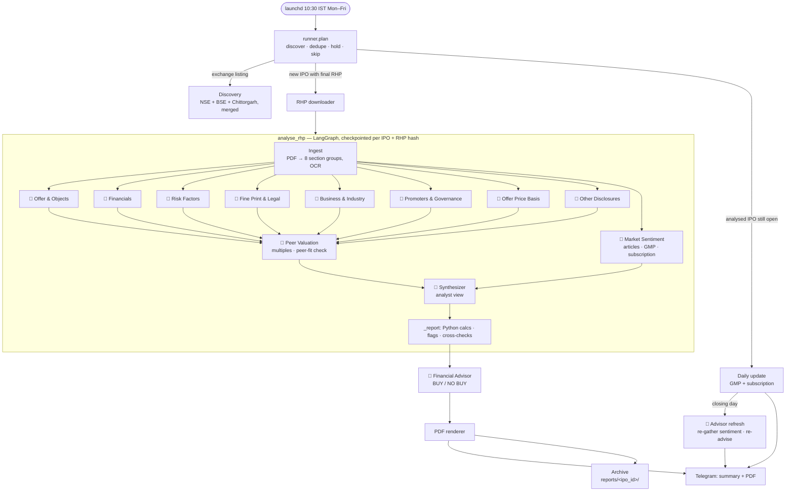
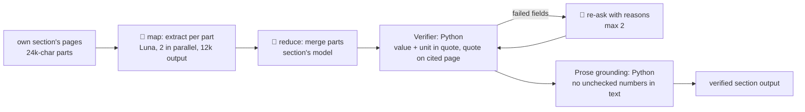

# Agents in the daily IPO run

This lists every agent and automated step that runs in the daily job, what each one sees, what it produces, and how context moves between them. For the full design, see `docs/specs/ipo-agents.md`.

Only steps marked 🤖 call a model. Everything else is deterministic Python. That split is intentional: discovery, parsing, maths, verification and rendering never use a model, so they can't make things up.

## The run at a glance

`launchd` starts the job at 10:30 IST on weekdays: `run_daily.py` → `cli.main` → `runner.run_daily`.

Inside each section agent, the same loop runs: **map → reduce → verify → retry (up to 2)**.

## The agents

### Models
| Key | Model | $/1M in · out | Used for |
|---|---|---|---|
| `luna` | `gpt-5.6-luna` (OpenAI) | 0.20 · 1.20 | Bulk reading (map), long or descriptive sections, sentiment aggregate. Reasoning effort `none`: at `low` it spent whole budgets reasoning and returned nothing. |
| `terra` | `gpt-5.6-terra` (OpenAI) | 2.00 · 12.00 | Steps that drive the decision, and the peer-fit check. Reasoning effort `low`. |
| `groq` | `openai/gpt-oss-120b` (Groq) | free tier | Small calls (verifier, stance tags). Any Groq failure, or a call over 6k tokens, falls back to Luna. |
| `sol` | `gpt-6.1-sol` (OpenAI) | 2.00 · 10.00 | Financial Advisor and Peer Valuation's choice of multiples (high reasoning effort) |

The routing lives in `config.yaml` (`routing:`). Once spend passes 70% of the $4.00 analysis cap, Terra tasks move down to Luna. Models with a reasoning effort are sent no temperature (Sol rejects it).

### Section agents
There are 8 section agents, all built on one generic engine (`section_agent.py`), each with its own prompt and schema (`sections.py`). Each one reads **only its own section's pages** and returns structured output. Every number in that output is a `Fact` (value, unit, page, verbatim quote), and every cited piece of text is a `Quote`.

| Agent | Who it is | Reads | Model (merge) | Python checks on its output |
|---|---|---|---|---|
| **Offer & Objects** | Offer-structure analyst | The Offer, Capital Structure, Objects of the Offer | Terra | OFS %, dilution, promoter holding change, GCP vs 25% cap (`calc.py`, `flags.py`) |
| **Financials** | Forensic accountant | Restated financials, MD&A | Terra (8k output) | PAT vs CFO, profit jump, receivable days, auditor remarks (`fin_calc.py`) |
| **Risk Factors** | Risk analyst | Risk Factors (top 25 kept, generic risks counted) | Luna (8k output) | Corroborates quantified risks with other sections (`cross_checks.py`) |
| **Fine Print & Legal** | Legal analyst | Litigation, approvals, material contracts, plus financial-note pages it borrows | Terra | Contingent liabilities vs net worth, related-party share of revenue, loans to promoters, criminal cases (`legal_calc.py`) |
| **Business & Industry** | Business analyst | Our Business, Industry Overview | Luna | Customer concentration, single plant or geography (`section_calc.py`) |
| **Promoters & Governance** | Governance analyst | Management, Promoters, Group Companies | Luna (its prompts exceed Groq's 6k limit) | Promoter pay vs PAT, pledges, conflicts, auditor/KMP churn |
| **Offer Price Basis** | Pricing analyst | Basis for Offer Price | Terra | Offer price vs WACA. Also extracts the RHP's peer table, the company's KPIs and the peers' operational KPIs from the "comparison of KPIs with listed peers" table (`peer_kpis`), all of which feed Peer Valuation |
| **Other Disclosures** | Compliance scanner | Every page no one else owns | Luna | None ("nothing material" is a valid answer); at most 10 items |

All 8 share:
- **Tools:** none. They only read the pages they're given; they can't browse.
- **Map calls:** Luna, with their own output limit (`map_max_tokens`, 12k). The section's own calls get `default_max_tokens` (16k).
- **Re-asks:** go to the section's own model.
- **Fail soft:** a section whose own reply can't be read (cut off or malformed) is marked "could not read" and skipped. Provider errors still fail the IPO, so the next run retries it.

### Market Sentiment 🤖 (`sentiment.py`)
- **Role:** collects what the market is saying, kept apart from RHP facts.
- **Tools:**
  - Tavily web search: reviews and broker notes published after the RHP. Spam filtered, at most 8 sources, or 4 when degraded.
  - InvestorGain: GMP, always labelled unofficial.
  - NSE subscription data, with Chittorgarh as fallback.
- **Models:**
  - Groq tags each article's stance, with the article fenced off as untrusted text.
  - Luna writes the bull and bear points.
- **Output:** third-party numbers only ever appear as `ClaimedFact`, which carries its source, URL and date.

### Peer Valuation 🤖 (`valuation.py`, `kpis.py`, `peers.py`)
Two model calls. Neither ever outputs a number.

**1. Choosing the multiples** (task `peer_valuation`, Sol at high effort):
- **Role:** an equity analyst who thinks about how this kind of business is valued, then picks 2 to 4 multiples, most important first, each with a reason.
- **Standard multiples:** P/E, EV/EBITDA, P/B (read with RoE, for lenders) and P/S (for loss-makers).
- **Business-specific multiples:** market cap or EV divided by a KPI the RHP discloses for the company and at least two peers. Examples: EV per subscriber (telecom), EV per bed (hospitals), EV per MW (power), EV per tonne (cement), market cap / AUM (lenders), EV/GMV (marketplaces), EV per employee (IT and BPO). The model names the KPI exactly as listed. A KPI that is a %, a ratio or days is never divided by.
- **Operating KPIs:** 3 to 6 KPIs to compare side by side with the peers (e.g. ARPU, attrition, revenue per employee).
- **Extra peers:** it may suggest up to 3 NSE-listed peers missing from the RHP's table. They are shown separately and set the median only when no RHP peer has data.
- **Sees:**
  - the business description, revenue mix and competitors;
  - the RHP's peer names;
  - whether the latest year is a profit or a loss;
  - the names of the KPIs the RHP discloses for the company and for its peers (with how many peers disclose each).

**2. Peer-fit check** (task `peer_fit`, Terra):
- **Role:** is each peer really a peer? For every RHP and suggested peer it gives a verdict (strong / partial / weak), 2 to 4 commonalities with the IPO and up to 3 differences.
- **Sees:** the IPO's business, revenue mix, competitors and claimed strengths, and each peer's Yahoo Finance sector, industry and business summary.
- **Weak peers are flagged, never dropped:** they stay in the median. `PEER_SET_WEAK` (info) is raised when most of the peers behind the median are weak.
- **Fails soft:** if the check fails, the peers are shown without verdicts.

**Tools (Python):**
- NSE quote and search, with manual symbol overrides in `config.yaml`, for price and market cap.
- yfinance for latest-year revenue, prior-year revenue, EBITDA, PAT, net worth, debt and cash, plus the company profile.
- `kpis.py` reads the RHP's KPI tables. It finds a KPI by name (footnote markers ignored) and a peer by name (prefix match). It takes the latest full fiscal year, never a stub. Rupee KPIs are converted to ₹ crore; counted ones keep their scale ("million subscribers").

**Calculations (Python):**
- IPO market cap and EV at the upper band.
- Every multiple, for the IPO and each peer. A KPI multiple is "×" for a rupee KPI and "₹ per unit" for a counted one.
- Peer median, min, max and the IPO's premium or discount.
- Each peer's revenue growth, EBITDA margin, PAT margin and RoE, set beside the IPO's own latest full year.
- For each operating KPI: the IPO's value, each peer's and the peers' median.
- Every input cites an RHP page or a third-party source and date. A missing number is reported as not computable, never filled in.

### Synthesizer 🤖 (`synthesizer.py`): the analyst view
- **Role:** gives a verdict (Subscribe long term / Listing gains / Neutral / Avoid) with reasons and red flags.
- **Model:** Terra, one call.
- **Sees:** an evidence digest of verified facts and derived numbers, flags, checks, the valuation read and sentiment. Every item carries an ID (`F:` `D:` `G:` `C:` `X:` `V:` `S:` `N:`).
- **Validation (Python):**
  - Points that cite an unknown ID are dropped, and so are points containing a number not in their cited evidence.
  - A Subscribe verdict backed only by GMP is downgraded to Neutral.

### Financial Advisor 🤖 (`advisor.py`)
- **Role:** an expert IPO advisor giving the headline **BUY / NO BUY**, with conviction, time horizon, reasons, key risks and what would change its mind.
- **Model:** `gpt-6.1-sol`, at high reasoning effort.
- **Budget:** its own ledger, `<ipo_id>:advisor`, with a $1.00 cap. It is separate from the analysis's $4.00.
- **Sees:**
  - The synthesizer's evidence digest.
  - The analyst view, as `A:` items.
  - Fresh market data, as `S:` items (only article points whose numbers are grounded).
  - Context, as `K:` items (days left to close, minimum investment).
  - It never sees raw RHP text.
- **Checks (Python):** same evidence-ID and number checks as the synthesizer. A BUY resting only on market data or the analyst view is cut to low conviction. Fewer than 2 surviving reasons means no advice.
- **When it runs:**
  - At the end of `analyse_rhp` on analysis day, so the PDF renders with the advisor box.
  - On closing-day morning, after reloading `report.json` and re-gathering sentiment. The ⏰ message shows "was NO BUY → now BUY" or "Same call".
  - Other daily updates repeat the analysis-day call with no model call.
- **Fails soft:** if the advisor errors or hits its $1.00 cap, the analysis summary and PDF still go out.

### Deterministic steps (no model)
| Step | Module | Does |
|---|---|---|
| Discovery | `discovery/` | Open mainboard IPOs from NSE, BSE and Chittorgarh. Every source is asked and the answers merged, the first source winning on duplicates. Filters out SME issues and holds DRHP-only IPOs. |
| RHP downloader | `discovery/download.py` | Streams the PDF from an https allowlist of hosts, with size and zip-bomb guards. |
| Ingestion | `ingestion.py` | Maps ToC pages to 8 groups, guarantees 100% page coverage, OCRs scanned pages. |
| Verifier | `verifier.py` | Checks each value and unit appear in its quote, and the quote is on the cited page (exactly, else a fuzzy match scoring 90+ whose matched text still holds the value). A zero printed as "Nil" or "-" counts. |
| Prose grounding | `grounding.py` | Strips or replaces model-written text that contains unchecked numbers. |
| Calcs, flags, cross-checks | `calc.py`, `*_calc.py`, `flags.py`, `cross_checks.py` | All arithmetic and every red flag, computed from verified inputs only. A rupee amount of zero is ₹0 whatever unit it is printed with (e.g. "Nil"). |
| KPI tables | `kpis.py` | Looks up the company's and peers' KPIs for Peer Valuation; latest full year, units to amounts. |
| Budget meter and router | `budget.py`, `router.py` | Checks worst-case cost before each call, logs actual cost after, handles degrade, Groq fallback and retries. |
| Renderer | `report/` | Report JSON → HTML → PDF with page references. Never calls a model. |
| Notifier | `notify/` | Telegram summary and PDF, daily GMP and subscription updates, closing reminders. The summary carries the advisor's call, reasons and risks in full; the valuation line; an operating-KPI line; a Peers block (one line per peer: verdict, multiples, revenue and growth, PAT margin, what it shares with the IPO); and "What the market is saying" (a Python read of stance tally, GMP and subscription). Messages over Telegram's 4,096 characters are split between lines. |
| Archive | `archive.py` | Saves each analysis under `reports/<ipo_id>/<date>_<time>[_partial]/` (report JSON, PDF, the exact summary sent) and each daily update under `updates/<date>.txt`. Archiving never stops a send. |

## How context is shared

There is no shared conversation between agents. Each model call is stateless and receives exactly the input listed below. Context moves only through typed, verified data.

| From → to | What travels | What is kept out |
|---|---|---|
| Ingest → section agent | That section's pages, tagged `[page N]` | Every other section's pages |
| Section agent → graph state | `findings[group]`, verified output only; `unverified` lists failed field paths | Rejected values (cleared to "could not verify") |
| Sections → Peer Valuation | Business description, revenue mix, competitors, RHP peer table, the KPI names in the RHP's KPI tables (values stay in Python), verified financials, shares and band | Raw pages; any number |
| Peer data → peer-fit check | Each peer's NSE symbol and Yahoo sector, industry and business summary | Peer numbers |
| All → Synthesizer | The evidence digest: verified items with IDs, derived numbers, flags, sentiment | Unverified values, raw text |
| Synthesizer + market → Advisor | The digest, the analyst view (`A:`) and fresh sentiment, GMP and subscription | Raw text; anything not in the digest |
| Report → renderer and Telegram | The `Report` model (Pydantic) | — |

LangGraph state (`analysis.AnalysisState`) has these fields:
- `ipo`, `rhp_pdf`, `doc`
- `findings`: one entry per section, merged
- `unverified`: appended to by each node
- `sentiment`, `valuation`, `synthesis`, `synthesis_error`

## Persistent memory

These are files the run reads and writes. All of them are local and gitignored.

| File | Written by | Read by | Holds |
|---|---|---|---|
| `data/ipo.db`, table `ipos` | Runner, Store | Runner, daily updates, dry run | Each IPO's status (`discovered`, `waiting_rhp`, `analysing`, `done`, `failed`, `failed_budget`), dates, band, symbol, verdict, report path, date of last update |
| `data/ipo.db`, table `llm_calls` | Budget meter | Budget meter, router, `--reset-budget` | Every model call: ledger, task, model, tokens, cost. Spend per IPO and Groq's 24-hour usage are summed from here. |
| `data/checkpoints.db` | LangGraph `SqliteSaver` | `analyse_rhp` on resume | Graph state per `ipo_id:rhp_sha256`. Deleted when a run finishes. |
| `data/work/<ipo_id>/` | Downloader, renderer, advisor | Analysis, closing-day refresh | `rhp.pdf`, `report_<SYMBOL>.pdf`, `report.json` (path also kept in `ipos.report_path`), `advice_<date>.json` |
| `reports/<ipo_id>/` | Archive | You | Every run's report JSON, PDF and Telegram text, plus daily updates. Re-runs get their own folder. |
| `config.yaml` | You | Everything | Models, prices, routing, caps, thresholds |
| `.env` | You | `wiring.py`, `cli.py` | API keys and the Telegram bot |
| `logs/ipo-agents.log` | CLI | You | Run logs. Secrets are never logged. |

## Budget across agents (per IPO)
- **Analysis ledger** (`<ipo_id>`, $4.00): all section agents, sentiment, peer valuation (both calls) and synthesizer. $0.40 is reserved for the verdict. At 70% of the cap it switches Terra steps to Luna. At 100% it sends a partial report and doesn't retry.
- **Advisor ledger** (`<ipo_id>:advisor`, $1.00): the advisor and its closing-day sentiment refresh.
- **In all:** $5.00 per IPO at most. Live runs: peer valuation's two calls cost about $0.02–0.05.
- **Free:** daily GMP and subscription updates, discovery, rendering and all Python steps.
