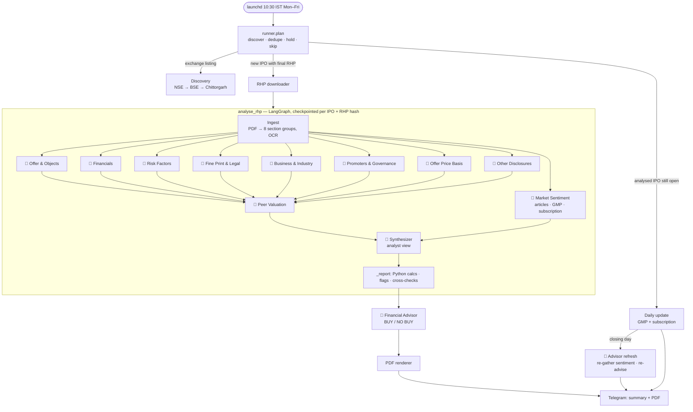
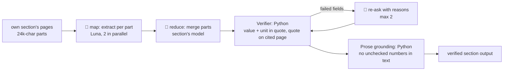

# Agents in the daily IPO run

This lists every agent and automated step that runs in the daily job, what each one sees, what it produces, and how context moves between them. For the full design, see `docs/specs/ipo-agents.md`.

Only steps marked 🤖 call a model. Everything else is deterministic Python. That split is intentional: discovery, parsing, maths, verification and rendering never use a model, so they can't make things up.

## The run at a glance

`launchd` starts the job at 10:30 IST on weekdays: `run_daily.py` → `cli.main` → `runner.run_daily`.

Inside each section agent, the same loop runs: **map → reduce → verify → retry (up to 2)**.

## The agents

### Models
| Key | Model | $/1M in · out | Used for |
|---|---|---|---|
| `luna` | `gpt-5.6-luna` (OpenAI) | 0.20 · 1.20 | Bulk reading (map), long or descriptive sections, sentiment aggregate |
| `terra` | `gpt-5.6-terra` (OpenAI) | 2.00 · 12.00 | Steps that drive the decision |
| `groq` | `openai/gpt-oss-120b` (Groq) | free tier | Small calls. Any Groq failure, or a call over 6k tokens, falls back to Luna. |
| `sol` | `gpt-6.1-sol` (OpenAI) | 2.00 · 10.00 | Financial Advisor (high reasoning effort) |

The routing lives in `config.yaml` (`routing:`). Once spend passes 70% of the $1.50 cap, Terra tasks move down to Luna.

### Section agents
There are 8 section agents, all built on one generic engine (`section_agent.py`), each with its own prompt and schema (`sections.py`). Each one reads **only its own section's pages** and returns structured output. Every number in that output is a `Fact` (value, unit, page, verbatim quote), and every cited piece of text is a `Quote`.

| Agent | Who it is | Reads | Model (merge) | Python checks on its output |
|---|---|---|---|---|
| **Offer & Objects** | Offer-structure analyst | The Offer, Capital Structure, Objects of the Offer | Terra | OFS %, dilution, promoter holding change, GCP vs 25% cap (`calc.py`, `flags.py`) |
| **Financials** | Forensic accountant | Restated financials, MD&A | Terra (8k output) | PAT vs CFO, profit jump, receivable days, auditor remarks (`fin_calc.py`) |
| **Risk Factors** | Risk analyst | Risk Factors (top 25 kept, generic risks counted) | Luna (8k output) | Corroborates quantified risks with other sections (`cross_checks.py`) |
| **Fine Print & Legal** | Legal analyst | Litigation, approvals, material contracts, plus financial-note pages it borrows | Terra | Contingent liabilities vs net worth, related-party share of revenue, loans to promoters, criminal cases (`legal_calc.py`) |
| **Business & Industry** | Business analyst | Our Business, Industry Overview | Luna | Customer concentration, single plant or geography (`section_calc.py`) |
| **Promoters & Governance** | Governance analyst | Management, Promoters, Group Companies | Groq (1.5k output) → Luna | Promoter pay vs PAT, pledges, conflicts, auditor/KMP churn |
| **Offer Price Basis** | Pricing analyst | Basis for Offer Price | Terra | Offer price vs WACA; the RHP's own peer table |
| **Other Disclosures** | Compliance scanner | Every page no one else owns | Groq → Luna | None ("nothing material" is a valid answer) |

All 8 share:
- **Tools:** none. They only read the pages they're given; they can't browse.
- **Map calls:** Luna.
- **Re-asks:** go to the section's own model.

### Market Sentiment 🤖 (`sentiment.py`)
- **Role:** collects what the market is saying, kept apart from RHP facts.
- **Tools:**
  - Tavily web search: reviews and broker notes published after the RHP. Spam filtered, at most 8 sources, or 4 when degraded.
  - InvestorGain: GMP, always labelled unofficial.
  - NSE subscription data, with Chittorgarh as fallback.
- **Models:**
  - Groq tags each article's stance, with the article fenced off as untrusted text.
  - Luna writes the bull and bear points.
- **Output:** third-party numbers only ever appear as `ClaimedFact`, which carries its source, URL and date.

### Peer Valuation 🤖 (`valuation.py`, `peers.py`)
- **Role:** decides which valuation multiples suit this business.
  - **P/B + RoE:** lenders.
  - **EV/EBITDA:** capex-heavy businesses.
  - **P/S:** loss-makers.
  - It may also suggest up to 3 extra peers.
- **Model:** Terra. It returns choices and reasons only, never numbers.
- **Tools (Python):** NSE quote and search, plus yfinance financials, for peer prices and fundamentals.
- **Calculations (Python):** IPO market cap at the upper band, the multiples, the peer median, min and max, and the premium.

### Synthesizer 🤖 (`synthesizer.py`): the analyst view
- **Role:** gives a verdict (Subscribe long term / Listing gains / Neutral / Avoid) with reasons and red flags.
- **Model:** Terra, one call.
- **Sees:** an evidence digest of verified facts and derived numbers, flags, checks, the valuation read and sentiment. Every item carries an ID (`F:` `D:` `G:` `C:` `X:` `V:` `S:` `N:`).
- **Validation (Python):**
  - Points that cite an unknown ID are dropped, and so are points containing a number not in their cited evidence.
  - A Subscribe verdict backed only by GMP is downgraded to Neutral.

### Financial Advisor 🤖 (`advisor.py`)
- **Role:** an expert IPO advisor giving the headline **BUY / NO BUY**, with conviction, time horizon, reasons, key risks and what would change its mind.
- **Model:** `gpt-6.1-sol`, at high reasoning effort.
- **Budget:** its own ledger, `<ipo_id>:advisor`, with a $0.50 cap. It is separate from the analysis's $1.50.
- **Sees:**
  - The synthesizer's evidence digest.
  - The analyst view, as `A:` items.
  - Fresh market data, as `S:` items (only article points whose numbers are grounded).
  - Context, as `K:` items (days left to close, minimum investment).
  - It never sees raw RHP text.
- **Checks (Python):** same evidence-ID and number checks as the synthesizer. A BUY resting only on market data or the analyst view is cut to low conviction. Fewer than 2 surviving reasons means no advice.
- **When it runs:**
  - At the end of `analyse_rhp` on analysis day, so the PDF renders with the advisor box.
  - On closing-day morning, after reloading `report.json` and re-gathering sentiment. The ⏰ message shows "was NO BUY → now BUY" or "Same call".
  - Other daily updates repeat the analysis-day call with no model call.
- **Fails soft:** if the advisor errors or hits its $0.50 cap, the analysis summary and PDF still go out.

### Deterministic steps (no model)
| Step | Module | Does |
|---|---|---|
| Discovery | `discovery/` | Open mainboard IPOs from NSE, falling back to BSE and Chittorgarh. Filters out SME issues and holds DRHP-only IPOs. |
| RHP downloader | `discovery/download.py` | Streams the PDF from an https allowlist of hosts, with size and zip-bomb guards. |
| Ingestion | `ingestion.py` | Maps ToC pages to 8 groups, guarantees 100% page coverage, OCRs scanned pages. |
| Verifier | `verifier.py` | Checks each value and unit appear in its quote, and the quote is on the cited page. Quotes must match exactly. |
| Prose grounding | `grounding.py` | Strips or replaces model-written text that contains unchecked numbers. |
| Calcs, flags, cross-checks | `calc.py`, `*_calc.py`, `flags.py`, `cross_checks.py` | All arithmetic and every red flag, computed from verified inputs only. |
| Budget meter and router | `budget.py`, `router.py` | Checks worst-case cost before each call, logs actual cost after, handles degrade, Groq fallback and retries. |
| Renderer | `report/` | Report JSON → HTML → PDF with page references. Never calls a model. |
| Notifier | `notify/` | Telegram summary and PDF, daily GMP and subscription updates, closing reminders. |

## How context is shared

There is no shared conversation between agents. Each model call is stateless and receives exactly the input listed below. Context moves only through typed, verified data.

| From → to | What travels | What is kept out |
|---|---|---|
| Ingest → section agent | That section's pages, tagged `[page N]` | Every other section's pages |
| Section agent → graph state | `findings[group]`, verified output only; `unverified` lists failed field paths | Rejected values (cleared to "could not verify") |
| Sections → Peer Valuation | Business description, RHP peer table, verified financials, shares and band | Raw pages |
| All → Synthesizer | The evidence digest: verified items with IDs, derived numbers, flags, sentiment | Unverified values, raw text |
| Synthesizer + market → Advisor | The digest, the analyst view (`A:`) and fresh sentiment, GMP and subscription | Raw text; anything not in the digest |
| Report → renderer and Telegram | The `Report` model (Pydantic) | — |

LangGraph state (`analysis.AnalysisState`) has these fields:
- `ipo`, `rhp_pdf`, `doc`
- `findings`: one entry per section, merged
- `unverified`: appended to by each node
- `sentiment`, `valuation`, `synthesis`, `synthesis_error`

## Persistent memory

These are files the run reads and writes. All of them are local and gitignored.

| File | Written by | Read by | Holds |
|---|---|---|---|
| `data/ipo.db`, table `ipos` | Runner, Store | Runner, daily updates, dry run | Each IPO's status (`discovered`, `waiting_rhp`, `analysing`, `done`, `failed`, `failed_budget`), dates, band, symbol, verdict, report path, date of last update |
| `data/ipo.db`, table `llm_calls` | Budget meter | Budget meter, router, `--reset-budget` | Every model call: ledger, task, model, tokens, cost. Spend per IPO and Groq's 24-hour usage are summed from here. |
| `data/checkpoints.db` | LangGraph `SqliteSaver` | `analyse_rhp` on resume | Graph state per `ipo_id:rhp_sha256`. Deleted when a run finishes. |
| `data/work/<ipo_id>/` | Downloader, renderer, advisor | Analysis, closing-day refresh | `rhp.pdf`, `report_<SYMBOL>.pdf`, `report.json` (path also kept in `ipos.report_path`), `advice_<date>.json` |
| `config.yaml` | You | Everything | Models, prices, routing, caps, thresholds |
| `.env` | You | `wiring.py`, `cli.py` | API keys and the Telegram bot |
| `logs/ipo-agents.log` | CLI | You | Run logs. Secrets are never logged. |

## Budget across agents (per IPO)
- **Analysis ledger** (`<ipo_id>`, $1.50): all section agents, sentiment, peer valuation and synthesizer. At 70% of the cap it switches Terra steps to Luna. At 100% it sends a partial report and doesn't retry.
- **Advisor ledger** (`<ipo_id>:advisor`, $0.50): the advisor and its closing-day sentiment refresh.
- **Free:** daily GMP and subscription updates, discovery, rendering and all Python steps.
